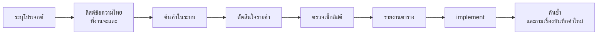

<div align="center">

# thai-word-check

**ให้ AI ใช้คำไทยคำเดียวกับที่ระบบของคุณใช้อยู่ ก่อนจะเขียนโค้ดบรรทัดแรก**

Agent Skill สำหรับ Claude Code และ agent ที่รองรับ `SKILL.md`

</div>

---

## ปัญหาที่สกิลนี้แก้

เวลาให้ AI เพิ่มฟีเจอร์ในแอปภาษาไทย มันมักตั้งคำใหม่เองทุกครั้ง หน้าหนึ่งใช้ "บันทึก" อีกหน้าใช้ "เซฟ" ปุ่มหนึ่งเขียน "ตั้งค่า" อีกปุ่มเขียน "การตั้งค่า" ผู้ใช้ที่เรียนรู้คำของระบบไปแล้วจึงสับสน

สกิลนี้บังคับให้ AI **ค้นคำที่ระบบใช้อยู่ก่อน** แล้วรายงานให้คุณเห็นว่าจะใช้คำไหน มาจากไหน ก่อนเริ่ม implement

> หลักการข้อเดียว: **คำที่ระบบมีอยู่แล้วชนะเสมอ**

## ตัวอย่างสิ่งที่ได้

สั่งว่า "เพิ่มปุ่มลบเอกสารพร้อมหน้าต่างยืนยัน" AI จะแสดงตารางนี้ก่อนเขียนโค้ด:

```
คำที่ใช้ → ที่มา → หมายเหตุ
เอกสาร → src/app/page.tsx:120 → ใช้อยู่แล้ว 6 จุด
ลบ → glossary กลาง → ปุ่มในแต่ละแถว ระบบยังไม่มีปุ่มลบ
ลบเอกสารนี้? → แม่แบบข้อความ → หัวข้อหน้าต่างยืนยัน
ลบเอกสาร → แม่แบบข้อความ → ปุ่มยืนยัน
ไม่ลบ → แม่แบบข้อความ → ปุ่มปิดหน้าต่างยืนยัน
ถังขยะ → (ใหม่) → เสนอ เพราะระบบยังไม่มีคำเรียกที่เก็บของที่ลบแล้ว
ข้อสังเกต: โปรเจกต์ยังไม่มี glossary ของตัวเอง; พบ "ตั้งค่า" กับ "การตั้งค่า" ใช้ปนกัน
```

ทุกคำบอกที่มา คำที่ AI ตั้งเองถูกทำเครื่องหมาย `(ใหม่)` ให้คุณเห็นชัด

## ทำงานอย่างไร



| ขั้น | AI ทำอะไร |
|---|---|
| 0 | ระบุโปรเจกต์ และหา glossary ของโปรเจกต์ใน repo |
| 1 | ลิสต์ทุกข้อความไทยที่จะเพิ่มหรือแก้ (ปุ่ม เมนู error ข้อความว่าง ฯลฯ) |
| 2 | ค้นทั้งโปรเจกต์ ทั้งคำตรงและคำพ้อง นับเฉพาะจุดที่ผู้ใช้เห็นจริง |
| 3 | เลือกคำตามลำดับความสำคัญ |
| 4 | ตรวจด้วยเช็กลิสต์ 10 ข้อ และใช้แม่แบบข้อความ |
| 5 | แสดงตาราง "คำที่ใช้ → ที่มา → หมายเหตุ" |
| 6 | หลัง implement ค้นซ้ำว่าคำตรงกับตาราง และถามก่อนบันทึกคำใหม่ |

### ลำดับความสำคัญของคำ

1. **คำที่ระบบใช้อยู่** ใน UI โค้ด เอกสาร และ test
2. **glossary** ตามลำดับ: glossary ของโปรเจกต์ → ไฟล์ตัวอย่างโปรเจกต์ → แม่แบบข้อความ → glossary กลาง
3. **คำใหม่** เมื่อสองข้อแรกไม่มีคำให้ใช้ โดยเลือกคำที่คนทั่วไปพูดกันก่อน

### AI หยุดถามคุณเมื่อไหร่

ส่วนใหญ่ AI จะแสดงตารางแล้วทำงานต่อเลย มันหยุดรอคำตอบเฉพาะเมื่อ:

- คำสองแบบมีความหมายทางกฎหมายหรือการเงินต่างกัน
- งานนั้นตั้งชื่อฟีเจอร์ ชื่อเมนูหลัก หรือแบรนด์ที่ระบบยังไม่มี
- ระบบใช้หลายคำปนกันและนับแล้วใกล้เคียงจนเลือกไม่ได้

## ติดตั้ง

**ใช้กับทุกโปรเจกต์** (macOS / Linux / Git Bash)

```bash
git clone https://github.com/koravut-Dev/thai-word-check-kit.git
```

```bash
mkdir -p ~/.claude/skills && cp -r thai-word-check-kit/thai-word-check ~/.claude/skills/
```

**Windows PowerShell**

```powershell
git clone https://github.com/koravut-Dev/thai-word-check-kit.git
New-Item -ItemType Directory -Force "$HOME\.claude\skills" | Out-Null
Copy-Item -Recurse thai-word-check-kit\thai-word-check "$HOME\.claude\skills\thai-word-check"
```

**ใช้เฉพาะโปรเจกต์เดียว** คัดลอกโฟลเดอร์ `thai-word-check/` ไปไว้ที่ `<โฟลเดอร์โปรเจกต์>/.claude/skills/thai-word-check/`

เปิด session ใหม่หลังติดตั้ง สกิลจะถูกโหลดเอง

## ใช้งาน

สกิลทำงานเองเมื่องานมีข้อความไทยในระบบเดิม เช่น "เพิ่มปุ่มลบเอกสาร" หรือ "แก้ข้อความ error ตอนอัปโหลด"

เรียกตรง ๆ ก็ได้:

```
เช็คคำไทยก่อนทำหน้าตั้งค่า
```

```
/thai-word-check
```

สกิลนี้**ไม่**ทำงานกับงานเขียนไทยทั่วไปที่ไม่มีระบบเดิมให้เทียบ เช่น อีเมล บทความ หรือการตอบแชท

## glossary ของโปรเจกต์

คำเฉพาะของแอปคุณ (ชื่อฟีเจอร์ ชื่อเมนู ศัพท์ของธุรกิจ) ควรอยู่ใน repo ของโปรเจกต์เอง เช่น `docs/glossary.md` เพื่อให้ทั้งทีมใช้ร่วมกันและอยู่ใน version control

- ครั้งแรกที่มีคำใหม่ AI จะเสนอสร้างไฟล์นี้ให้จากแม่แบบ `_template.md`
- **AI ไม่เขียน glossary เองโดยไม่ถาม** คำถามจะระบุทุกคำพร้อมไฟล์ปลายทาง และคำตอบรับครอบคลุมเฉพาะไฟล์ที่ระบุ
- ถ้าโค้ดจริงใช้คำต่างจาก glossary AI จะยึดโค้ดและแจ้งคุณ

## โครงสร้าง

```
thai-word-check/
├── SKILL.md                      ขั้นตอนหลักและกฎ
└── references/
    ├── glossary.md               glossary กลาง คำพ้องที่ต้องค้น รูปแบบตัวเลข/วันที่
    ├── checklist.md              เช็กลิสต์ 10 ข้อก่อนเขียนข้อความ
    ├── message-patterns.md       แม่แบบข้อความ สำเร็จ / ผิดพลาด / ว่าง / ยืนยัน
    └── projects/
        └── _template.md          แม่แบบ glossary ของโปรเจกต์
```

## สิ่งที่อยู่ใน glossary กลาง

| หมวด | ตัวอย่าง |
|---|---|
| คำปุ่ม | Save = บันทึก · Delete = ลบ · Retry = ลองอีกครั้ง · Restore = กู้คืน |
| ส่วนของหน้าจอ | Settings = ตั้งค่า · Notification = การแจ้งเตือน |
| สถานะ | Failed = ไม่สำเร็จ · Empty = ยังไม่มี[สิ่งนั้น] |
| รูปแบบ | `13 พ.ย. 2569` · `1,250.50 บาท` · `3 จาก 10 รายการ` |
| แม่แบบ error | เกิดอะไร → เพราะอะไร → ทำอะไรต่อ |

ทั้งหมดเป็นค่าเริ่มต้น ถ้าระบบของคุณใช้คำหรือรูปแบบอื่นอยู่แล้ว สกิลจะยึดของระบบ

## ข้อกำหนด

- Agent ที่อ่าน `SKILL.md` ได้ (ทดสอบกับ Claude Code)
- เครื่องมือค้นข้อความในโปรเจกต์ เช่น grep หรือ ripgrep
- ไม่มี script และไม่ส่งข้อมูลออกนอกเครื่อง สกิลเป็นไฟล์ Markdown ทั้งหมด
